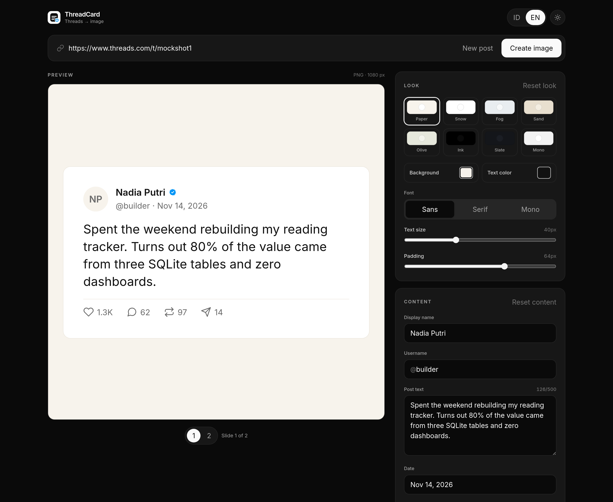

# ThreadCard

[](https://nextjs.org)
[](https://react.dev)
[](https://www.typescriptlang.org)
[](https://tailwindcss.com)
[](#getting-started)
[](https://github.com/zalramadhan/threadcard/stargazers)

Turn a public Threads post into a customisable image card you can download as PNG.

Paste a Threads URL, tweak the text and styling, export at 1080 px wide. No login, no watermark, no QR code, no tracking.



## Features

- **Paste and go** — accepts the usual public link shapes (see below). Share links are resolved server-side through Threads' redirect chain, restricted to Threads hosts.
- **Manual fallback** — if scraping is blocked or the post is private, fill in the text, name and handle yourself.
- **Editable everything** — each card's text, display name, handle, timestamp, counts and avatar (upload up to 2 MB) can be overridden before export.
- **Multi-slide threads** — up to 10 slides in one thread (same author), with a slide switcher and "download all".
- **8 themes** — plus full control over background, text colour, accent colour, font family, font size and padding.
- **Aspect ratios** — auto (1080–2400 px tall), 1:1 (1080×1080), 4:5 (1080×1350) and 9:16 (1080×1920).
- **PNG export** — rendered client-side at 2× and downscaled to 1080 px wide, plus copy-to-clipboard.
- **Card toggles** — avatar, verified badge, timestamp, engagement counts and media.
- **Rich text** — mentions and hashtags are coloured, long posts truncate with a "See more" line.
- **Bilingual UI** — Indonesian and English.
- **Dark mode** — follows the system preference on first load, remembers your choice.

## Accepted links

```
https://www.threads.com/@user/post/{code}
https://www.threads.com/@user/post/{code}/{slug}
https://www.threads.com/t/{code}
https://www.threads.com/share/{code}
```

`threads.net` works too, and the protocol can be omitted.

## Stack

Next.js 16 (App Router) · React 19 · TypeScript · Tailwind CSS 4 · `modern-screenshot`

## Getting started

Requires Node.js 20.9 or newer.

```bash
npm install
npm run dev
```

Open http://localhost:3000.

```bash
npm run typecheck   # tsc --noEmit
npm run lint        # eslint
npm run build       # production build
```

No environment variables are required.

## How it works

| Path | Purpose |
| --- | --- |
| `app/page.tsx` | Shell for the editor |
| `app/api/fetch-post/route.ts` | Resolves share links, scrapes the post, returns normalised slides |
| `app/api/image/route.ts` | Proxies avatar/media images (https only, host allow-list, max 8 MB, 4 redirect hops) |
| `lib/url.ts` | URL parsing (`post` / `share` discriminated union) |
| `lib/scrape.ts` | Fetches the Threads page and parses embedded `data-sjs` payloads, with Open Graph fallback |
| `lib/themes.ts` | Theme presets |
| `lib/format.ts` | Canvas constants and text-line estimation |
| `lib/export.ts` | Client-side PNG rendering |
| `components/` | Editor UI, card mockup, preview, controls |

Scraping uses a crawler user agent and reads the JSON already embedded in the public page. There is no database, no analytics and no server-side storage — everything you edit stays in the browser.

### Limitations

Threads changes its markup regularly and rate-limits anonymous traffic, so scraping can fail. When it does, the app says why (not found, private/blocked, rate limited, timeout) and offers manual entry. Only public posts by a single author can be turned into a card.

## Note

Unofficial project, not affiliated with Threads or Meta. Only use it with public content, and credit the original author.
